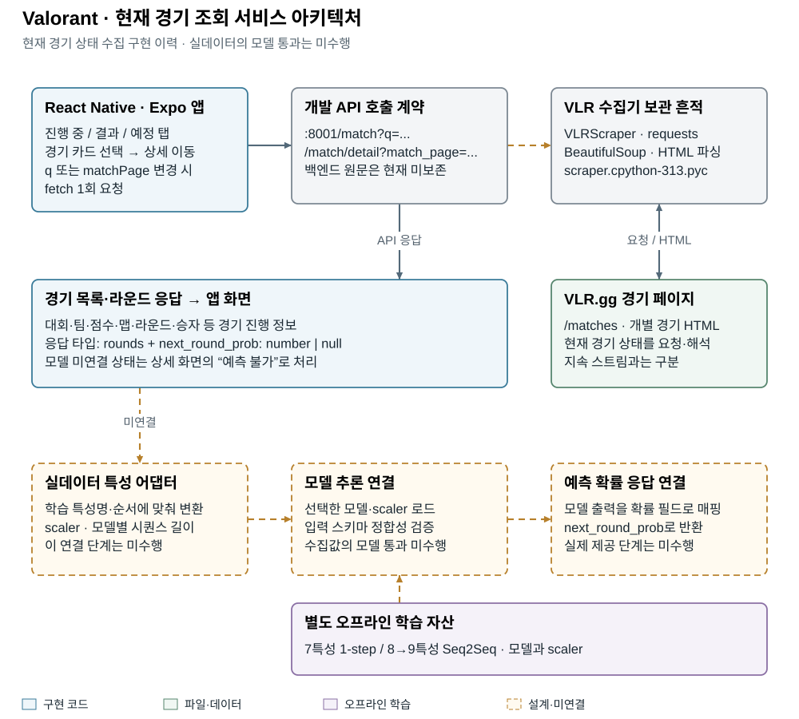
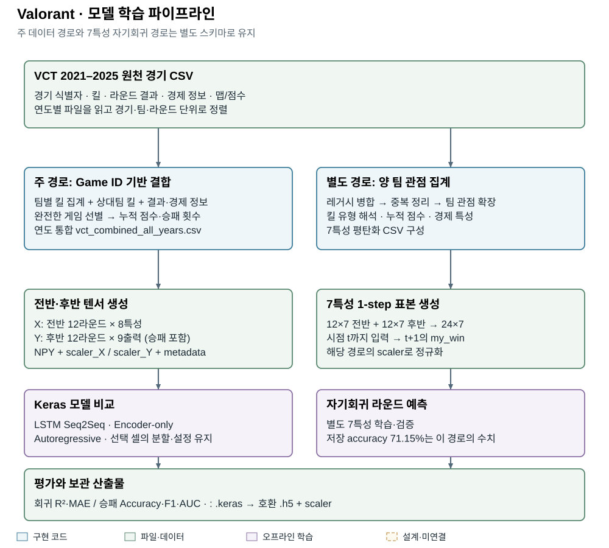

# Valorant 경기 조회와 라운드 예측

VCT 2021–2025 경기 데이터를 라운드·팀 관점으로 구성해 후반 라운드를 예측하는 연구와, VLR.gg 현재 경기 상태를 조회하는 Expo 앱으로 구성된다. 기록상 주요 연구와 앱 수정 시점은 2025년 12월이다.

**경기 데이터 수집·전처리, 모델 설계·학습, VLR.gg 수집과 백엔드, 프런트 수정까지 기술 구현 전반을 직접 담당했습니다.** PM으로 일정 조율과 핵심 기능 제안도 맡았습니다.

[프로젝트 소개 1쪽](docs/project_overview.pdf) · [구현 범위와 모델 연결 경계](docs/implementation_scope.md)

## 본인 기여

| 영역 | 본인 담당 범위 |
|---|---|
| PM | 프로젝트 일정 조율과 핵심 기능 제안 |
| 데이터 | 경기 데이터 수집·전처리와 라운드 시퀀스 구성 |
| 모델 | 예측 모델 설계·학습·평가 |
| 조회 서버 | VLR.gg 현재 경기 수집과 백엔드 |
| 프런트 | 조회 화면의 데이터 연결과 프런트 수정 |

과거 경기 데이터를 사용하는 오프라인 모델 연구와 현재 경기 상태를 조회하는 서비스를 구현했습니다. 현재 수집값을 실제 예측 모델에 전달하는 연결 단계는 수행하지 않았으므로 두 흐름을 구분합니다.

주요 코드: [Game ID 데이터 구성](notebooks/01_build_game_id_round_dataset.ipynb), [Seq2Seq 연구](notebooks/03_train_first_half_to_second_half_seq2seq.ipynb), [조회 화면](frontend/app/index.tsx), [목록 요청](frontend/hooks/useMatchList.ts), [상세 요청](frontend/hooks/useMatchDetail.ts).

## 데이터와 모델

Game ID 데이터 결합 → 누적 점수·연도 통합 → 12×8 입력에서 12×9 출력의 Seq2Seq 경로를 사용한다. 별도 7특성 경로는 24라운드 시계열에서 다음 라운드 승패를 학습하며 저장 accuracy는 71.15%다. 두 입력 스키마와 평가 조건은 구분한다.

## 서비스 범위

`frontend`는 경기 목록과 상세 API를 호출하며, 탭·경기 선택이 변경될 때 현재 경기 상태를 가져옵니다. 공개 소스에는 모델 연구 노트북과 Expo 앱이 포함됩니다. 당시 조회 백엔드 원문은 보관본에 남아 있지 않습니다. 수집 데이터의 모델 연결 범위는 [구현 범위 문서](docs/implementation_scope.md)에 정리했습니다.

## 실행 구성

노트북은 공개 데이터와 모델별 scaler 및 텐서 경로를 설정해 사용한다. Expo 앱은 `frontend`에서 의존성을 설치한 뒤 실행하며 별도 개발 API 주소를 구성해야 한다. 초기 병합 셀이 함께 남은 1-step 노트북에서는 7특성 학습·호환 내보내기 경로를 선택해 읽는다.

## 아키텍처

## 대표 노트북

| 파일 | 목적 |
|---|---|
| [03_train_first_half_to_second_half_seq2seq.ipynb](notebooks/03_train_first_half_to_second_half_seq2seq.ipynb) | 8특성 입력과 9특성 출력 Seq2Seq 실험 |
| [04_train_one_step_autoregressive_model.ipynb](notebooks/04_train_one_step_autoregressive_model.ipynb) | 초기 병합부터 1-step 자기회귀와 내보내기 |
| [02_add_cumulative_scores_and_merge_years.ipynb](notebooks/02_add_cumulative_scores_and_merge_years.ipynb) | 누적 점수 부여와 전체 연도 통합 |
| [01_build_game_id_round_dataset.ipynb](notebooks/01_build_game_id_round_dataset.ipynb) | Game ID 기반 라운드 데이터 재구성 |

## 데이터와 환경

대규모 데이터·가중치·인증 파일·가상환경은 별도로 준비합니다. 노트북의 실행 경로와 설정값은 사용하는 환경에 맞게 지정합니다. 노트북은 목적별로 선별하고 파일명을 정리했으며, 원래 파일명과 원본 수정 시점은 [노트북 대응표](docs/notebook_index.csv)에 기록했습니다.
